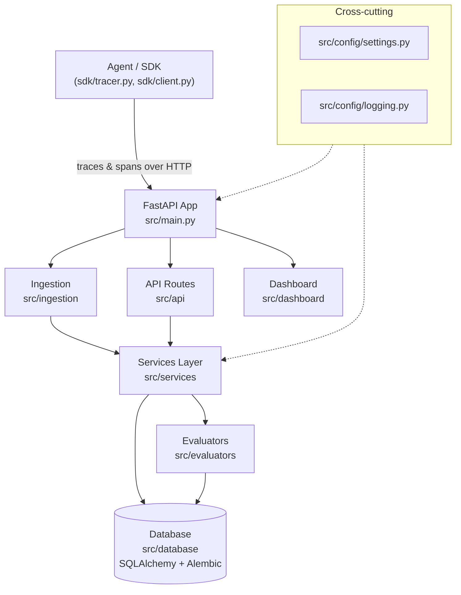

# Agent Observability Service

A FastAPI-based service for ingesting, storing, querying, and evaluating traces and spans from AI agents.

## System Architecture

```
                         +--------------------+
                         |   Agent / SDK       |
                         |   (sdk/tracer.py)   |
                         +----------+----------+
                                    | traces/spans (HTTP)
                                    v
                         +--------------------+
                         |   FastAPI App       |
                         |   (src/main.py)      |
                         +----------+----------+
                                    |
              +---------------------+----------------------+
              |                     |                       |
              v                     v                       v
   +-------------------+  +-------------------+   +---------------------+
   |  Ingestion         |  |  API Routes       |   |  Dashboard           |
   |  (src/ingestion)   |  |  (src/api)        |   |  (src/dashboard)     |
   |  - trace_receiver   |  |  - routes          |   |  - views             |
   |  - batch_ingest     |  |  - middleware      |   +---------------------+
   |  - span_parser      |  |  - schemas         |
   +---------+-----------+  +---------+---------+
              |                        |
              v                        v
   +--------------------------------------------+
   |              Services Layer                 |
   |  (src/services)                              |
   |  - trace_service     - metrics_service       |
   |  - evaluation_service- comparison_service    |
   |  - alert_service     - notification_service  |
   +---------------------+------------------------+
                         |
            +------------+-------------+
            v                          v
   +-------------------+      +----------------------+
   |  Evaluators         |      |  Database             |
   |  (src/evaluators)   |      |  (src/database)       |
   |  - judge_llm         |      |  SQLAlchemy models    |
   |  - rule_based_checks |      |  + Alembic migrations |
   |  - cost_calculator   |      +----------------------+
   +---------------------+
```



## Project Structure

See the repository layout above. Key directories:

- `src/` — Application source code
- `sdk/` — Thin client library for agent projects
- `tests/` — Unit and integration tests
- `scripts/` — Database init and seeding scripts
- `docker/` — Docker compose and Dockerfile
- `docs/` — Architecture, SDK usage, and API reference

## Getting Started

```bash
pip install -r requirements.txt
cp .env.example .env
# edit .env with your settings
uvicorn src.main:app --reload
```

## License

MIT
